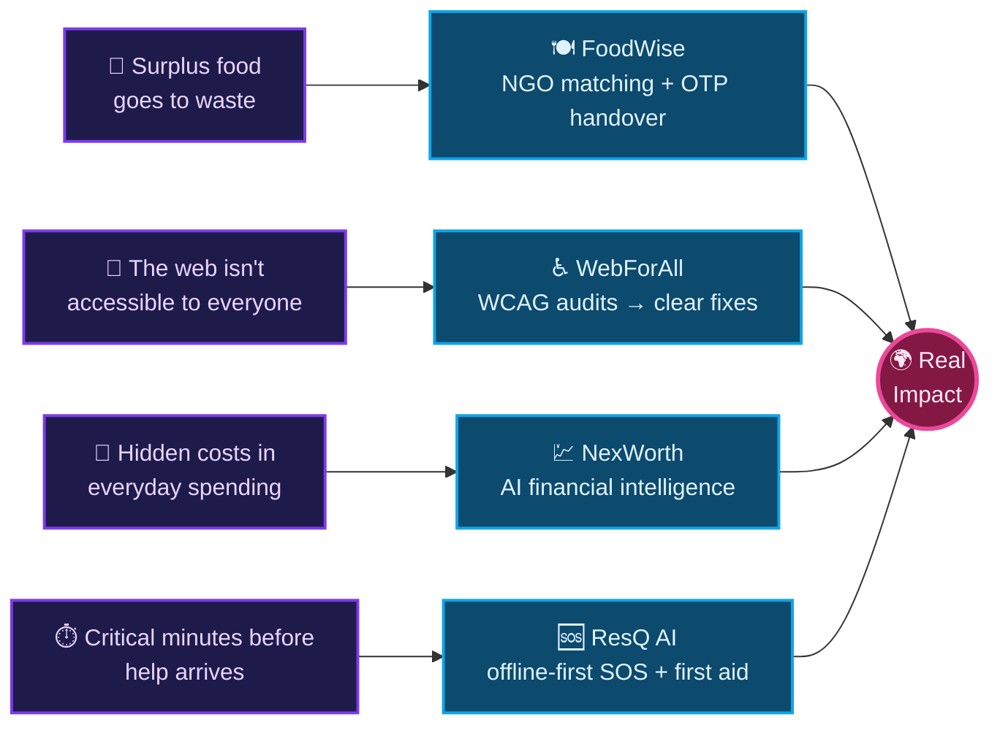

  

  

  
  
  
  

  
  
  

  <a href="#-the-builder-behind-the-code"><b>About</b></a> &nbsp;·&nbsp;
  <a href="#mission-map"><b>Mission Map</b></a> &nbsp;·&nbsp;
  <a href="#-featured-projects"><b>Projects</b></a> &nbsp;·&nbsp;
  <a href="#-technology-constellation"><b>Stack</b></a> &nbsp;·&nbsp;
  <a href="#-live-github-pulse"><b>GitHub Pulse</b></a> &nbsp;·&nbsp;
  <a href="#-open-a-channel"><b>Contact</b></a>

  

## ⚡ The Builder Behind the Code

I'm a **second-year Computer Science Engineering student** building products where engineering meets real-world impact: **food redistribution, digital accessibility, financial intelligence, and emergency first response**. I enjoy taking ambitious ideas from a rough concept to a working, thoughtful experience.

 

  

<strong>🗂️ Open the developer dossier</strong>

 

- 🔭 **Currently exploring:** AI integration, robust backend systems, data structures and algorithms.
- 💜 **I care about:** accessibility, privacy-aware design, dependable workflows, and products that help people.
- 💬 **Ask me about:** hackathons, AI product ideas, full-stack web apps, and turning an idea into a prototype.
- 🤝 **Open to:** meaningful collaborations, open-source work, and challenging product problems.

## 🗺️ Problems I Chose to Solve

Every project starts with a real problem, not a tech stack.

## ✨ Featured Projects

<table>
  <tr>
    <td width="50%" align="center" valign="top">
      
       
      
      
    </td>
    <td width="50%" align="center" valign="top">
      
       
      
      
    </td>
  </tr>
  <tr>
    <td width="50%" align="center" valign="top">
      
       
      
      
    </td>
    <td width="50%" align="center" valign="top">
      
       
      
      
    </td>
  </tr>
</table>

  

<strong>📌 Open the project showcase</strong>

 

  
  

  
  

## 🧩 Technology Constellation

  

  

| Domain | Tools I work with |
| :-- | :-- |
| 🧠 **Languages** | Python, TypeScript, JavaScript, HTML, CSS |
| 🎨 **Frontend** | React, Next.js, Tailwind CSS, Vite |
| ⚙️ **Backend & Data** | Node.js, Express, MongoDB, REST APIs |
| 🤖 **AI & Product** | Groq, Gemini, accessibility engineering, PWA design |
| 🚀 **Ship & Collaborate** | Git, GitHub, Vercel, Figma |

## 📡 Live GitHub Pulse

  <picture>
    <source media="(prefers-color-scheme: dark)" srcset="https://github-readme-stats.vercel.app/api?username=nabeel05-ship-it&show_icons=true&theme=tokyonight&title_color=60a5fa&icon_color=60a5fa&text_color=cbd5e1&hide_border=true&bg_color=00000000&count_private=true&include_all_commits=true&hide_rank=true" />
    
  </picture>
  <picture>
    <source media="(prefers-color-scheme: dark)" srcset="https://github-readme-stats.vercel.app/api/top-langs/?username=nabeel05-ship-it&layout=compact&theme=tokyonight&title_color=60a5fa&text_color=cbd5e1&hide_border=true&bg_color=00000000&langs_count=8" />
    
  </picture>

  <picture>
    <source media="(prefers-color-scheme: dark)" srcset="https://streak-stats.demolab.com?user=nabeel05-ship-it&theme=tokyonight&hide_border=true&background=00000000&ring=60A5FA&fire=EC4899&currStreakLabel=60A5FA" />
    
  </picture>

  

<strong>📊 Open the activity vault</strong>

 

  

  
  

  
  

## 🐍 Contribution Garden

  <picture>
    <source media="(prefers-color-scheme: dark)" srcset="https://raw.githubusercontent.com/nabeel05-ship-it/nabeel05-ship-it/output/github-contribution-grid-snake-dark.svg" />
    <source media="(prefers-color-scheme: light)" srcset="https://raw.githubusercontent.com/nabeel05-ship-it/nabeel05-ship-it/output/github-contribution-grid-snake.svg" />
    
  </picture>

Auto-refreshed daily from my GitHub contribution history.

## 📬 Open a Channel

If you're working on an <b>AI product</b>, <b>accessibility initiative</b>, <b>social-impact platform</b>, or an <b>ambitious full-stack idea</b>, I'd love to connect and explore it together.

  
  
  

  

<a href="#top">⬆ Back to top</a>

  

