

  

  
  
  
  

  

  

I'm a **second-year Computer Science Engineering student** building products where engineering meets real-world impact: **food redistribution, digital accessibility, financial intelligence, and emergency first response**. I enjoy taking ambitious ideas from a rough concept to a working, thoughtful experience.

  

  

  

<table>
  <tr>
    <td width="50%" align="center" valign="top">
      <a href="https://food-wise-henna.vercel.app/"></a>
       
      
      
    </td>
    <td width="50%" align="center" valign="top">
      
       
      
      
    </td>
  </tr>
  <tr>
    <td width="50%" align="center" valign="top">
      <a href="https://nexworth-ten.vercel.app/"></a>
       
      
      
    </td>
    <td width="50%" align="center" valign="top">
      
       
      
      
    </td>
  </tr>
</table>

  

  

  

  

  

  <picture>
    <source media="(prefers-color-scheme: dark)" srcset="https://github-readme-stats.vercel.app/api?username=nabeel05-ship-it&show_icons=true&theme=tokyonight&title_color=60a5fa&icon_color=60a5fa&text_color=cbd5e1&hide_border=true&bg_color=00000000&count_private=true&include_all_commits=true&hide_rank=true" />
    
  </picture>
  <picture>
    <source media="(prefers-color-scheme: dark)" srcset="https://github-readme-stats.vercel.app/api/top-langs/?username=nabeel05-ship-it&layout=compact&theme=tokyonight&title_color=60a5fa&text_color=cbd5e1&hide_border=true&bg_color=00000000&langs_count=8" />
    
  </picture>

  <picture>
    <source media="(prefers-color-scheme: dark)" srcset="https://streak-stats.demolab.com?user=nabeel05-ship-it&theme=tokyonight&hide_border=true&background=00000000&ring=60A5FA&fire=EC4899&currStreakLabel=60A5FA" />
    
  </picture>

  <picture>
    <source media="(prefers-color-scheme: dark)" srcset="https://raw.githubusercontent.com/nabeel05-ship-it/nabeel05-ship-it/output/github-contribution-grid-snake-dark.svg" />
    <source media="(prefers-color-scheme: light)" srcset="https://raw.githubusercontent.com/nabeel05-ship-it/nabeel05-ship-it/output/github-contribution-grid-snake.svg" />
    
  </picture>

  

  <a href="mailto:nabeelsaroshahmed@gmail.com"></a>

  
  
  

  

